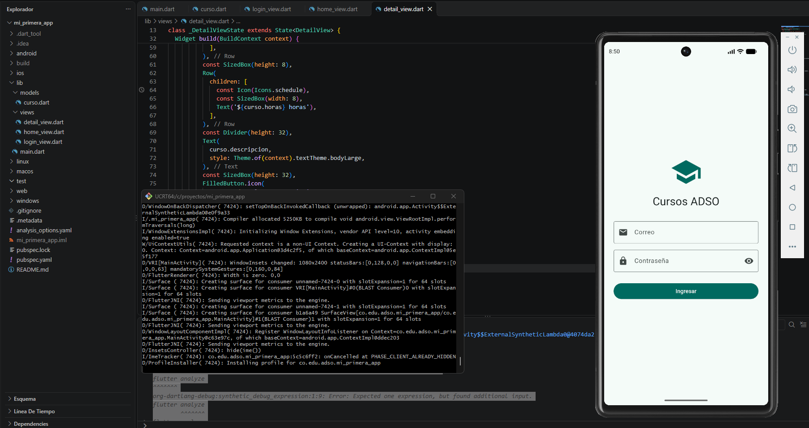
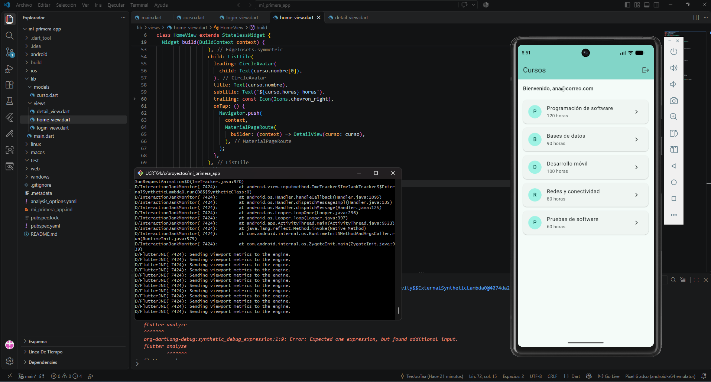
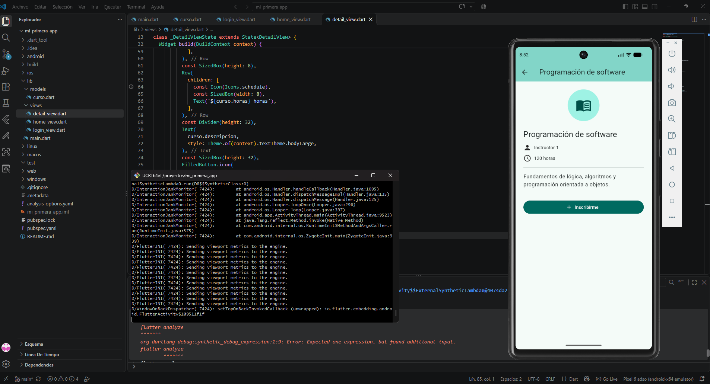
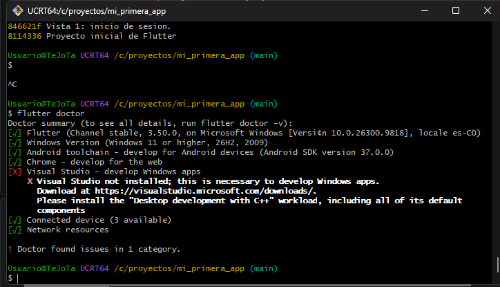
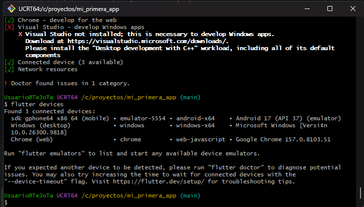

# Cursos ADSO

## Participante
- Tatiana Jimenez

## Descripción del proyecto

Cursos ADSO es una aplicación móvil desarrollada con Flutter como parte del proceso de formación. La aplicación permite iniciar sesión, visualizar una lista de cursos y consultar los detalles de cada curso.

## Vistas de la aplicación

### 1. Inicio de sesión

### 2. Lista de cursos

### 3. Detalle del curso

## Evidencias del entorno de desarrollo

### Flutter Doctor

### Flutter Devices

## Tecnologías utilizadas
- Flutter
- Dart
- Visual Studio Code
- Git y GitHub